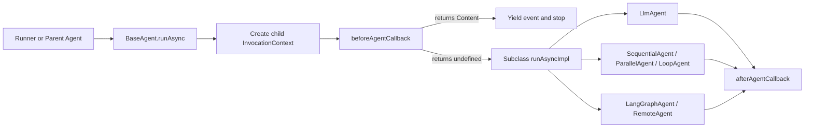

# Agents

The `agents` subsystem defines the executable agent hierarchy, orchestration shells, external framework adapters, and per-invocation execution contexts in `@google/adk`. Every agent extends `BaseAgent`, which manages parent-child agent trees, lifecycle callbacks, and invocation cost tracking across single-agent and multi-agent runs:

- `BaseAgent` and `isBaseAgent` - Abstract base class for all agents, providing hierarchy management, `beforeAgentCallback` and `afterAgentCallback` hooks, `clone`, and `runAsync` and `runLive` entry points.
- `LlmAgent`, `Agent`, and `isLlmAgent` - Language-model agent supporting instructions, tools, structured schemas, context compactors, planners, code executors, and agent transfer.
- `SequentialAgent`, `ParallelAgent`, and `LoopAgent` - Deterministic orchestration agents that run `subAgents` in sequence, concurrently on isolated branches, or repeatedly until escalation.
- `LangGraphAgent`, `isLangGraphAgent`, `getLastHumanMessages`, `LangGraphHumanMessage`, `LangGraphAIMessage`, and `LangGraphSystemMessage` - Adapter agent that wraps a compiled LangGraph state graph (`CompiledGraphLike`) for single-turn and multi-turn execution.
- `RemoteAgent` and `isRemoteAgent` - Experimental agent that forwards invocation context and session state (with `null` and `undefined` schema fields stripped and timestamps converted between milliseconds and seconds) to an external HTTP endpoint and re-authors returned events.
- `InvocationContext`, `ReadonlyContext`, `Context`, `CallbackContext`, `LlmCallsLimitExceededError`, and `isLlmCallsLimitExceededError` - Per-invocation state containers, callback and tool context wrappers, and shared LLM call budget enforcement.
- `RunConfig`, `createRunConfig`, `StreamingMode`, `LiveRequestQueue`, `ActiveStreamingTool`, and `TranscriptionEntry` - Runtime configuration, bidirectional request queueing, live streaming tool tracking, and audio transcription buffering.

## Introduction

An ADK application models each autonomous unit or orchestration stage as a `BaseAgent` instance. At run time, `Runner.runAsync` or `Runner.runLive` constructs a root `InvocationContext` carrying the active `Session`, `RunConfig`, service handles, and a shared cost manager, then delegates execution to `rootAgent.runAsync` or `rootAgent.runLive`.

When an agent delegates to child agents in `subAgents`, each child receives a cloned `InvocationContext` bound to that child agent while sharing the root invocation's LLM call counter. Read-only instruction providers inspect the run through `ReadonlyContext`, while lifecycle and model callbacks mutate `session.state` and save session artifacts through `Context`, which is also exported as `CallbackContext`.

## Get started

Build a two-stage `SequentialAgent` pipeline where a research `LlmAgent` calls a `FunctionTool` and writes its result to `session.state` via `outputKey`, and a writer `LlmAgent` reads that state placeholder to produce the final response:

```ts
import {
  FunctionTool,
  InMemoryRunner,
  LlmAgent,
  SequentialAgent,
  isFinalResponse,
  stringifyContent,
} from '@google/adk';
import {z} from 'zod';

const lookupCityFact = new FunctionTool({
  name: 'lookup_city_fact',
  description: 'Returns a short fact about a city.',
  parameters: z.object({
    city: z.string().describe('City name.'),
  }),
  execute: async ({city}) => ({
    city,
    fact: `${city} is known for its historic architecture.`,
  }),
});

const researcher = new LlmAgent({
  name: 'researcher',
  model: 'gemini-flash-latest',
  instruction: 'Look up a city fact and store a summary.',
  tools: [lookupCityFact],
  outputKey: 'research_notes',
});

const writer = new LlmAgent({
  name: 'writer',
  model: 'gemini-flash-latest',
  instruction: 'Write a one-sentence travel headline using: {research_notes}',
});

export const pipeline = new SequentialAgent({
  name: 'travel_headline_pipeline',
  subAgents: [researcher, writer],
});

export async function runPipeline(): Promise<string[]> {
  const runner = new InMemoryRunner({
    agent: pipeline,
    appName: 'agents_guide_demo',
  });

  const session = await runner.sessionService.createSession({
    appName: 'agents_guide_demo',
    userId: 'user_1',
  });

  const outputs: string[] = [];
  for await (const event of runner.runAsync({
    userId: session.userId,
    sessionId: session.id,
    newMessage: {
      role: 'user',
      parts: [{text: 'Tell me about Kyoto.'}],
    },
  })) {
    if (isFinalResponse(event)) {
      outputs.push(`${event.author}: ${stringifyContent(event)}`);
    }
  }
  return outputs;
}
```

## How it works

Every call to `agent.runAsync(parentContext)` or `agent.runLive(parentContext)` follows a uniform lifecycle managed by `BaseAgent`:



1. **Tree construction and cloning**: `new BaseAgent(config)` validates that `name` is a valid JavaScript identifier other than `'user'` and links each child in `subAgents` by setting `child.parentAgent = this`. An agent instance can belong to only one parent; calling `agent.clone(overrides)` constructs a detached copy with recursively cloned `subAgents`.
2. **Context propagation and cost tracking**: `BaseAgent` creates a child `InvocationContext` for each agent call. The child context copies the parent's `invocationId`, `session`, `runConfig`, and internal cost manager so `ctx.incrementLlmCallCount()` enforces `runConfig.maxLlmCalls` across the entire invocation tree and throws `LlmCallsLimitExceededError` when exceeded.
3. **Lifecycle callbacks and context layers**:
   - `ReadonlyContext` exposes read-only `invocationId`, `agentName`, `userId`, `sessionId`, `userContent`, `state`, and `a2aMetadata` to `InstructionProvider` functions.
   - `Context`, aliased as `CallbackContext`, extends `ReadonlyContext` with a delta-recording `state` (`State`), `actions` (`EventActions`), `loadArtifact`, `saveArtifact`, `listArtifacts`, `searchMemory`, `requestCredential`, `getAuthResponse`, and `requestConfirmation`.
   - `beforeAgentCallback` runs before `runAsyncImpl`. If any callback in the list returns a `Content` object, `BaseAgent` yields an event carrying that content and skips both `runAsyncImpl` and `afterAgentCallback`.
   - `afterAgentCallback` runs after `runAsyncImpl` finishes and can emit a trailing event by returning a `Content` object.
4. **Live streaming and transcription helpers**:
   - `LiveRequestQueue` is an async FIFO queue of `LiveRequest` items (`content`, `blob`, `activityStart`, `activityEnd`, `close`) that feeds bidirectional `runLive` sessions and Compositional Function Calling (`runConfig.supportCfc`).
   - `ActiveStreamingTool` pairs a background `Task<void>` and an optional input `LiveRequestQueue` for live streaming tools stored in `invocationContext.activeStreamingTools`.
   - `TranscriptionEntry` records `{role, data}` entries (`Blob` or `Content`) in `invocationContext.transcriptionCache` for speech transcription.

## Configuration options

Agents and invocations are configured through `BaseAgentConfig`, `LlmAgentConfig`, `LoopAgentConfig`, `LangGraphAgentConfig`, `RemoteAgentConfig`, and `RunConfig`.

### `BaseAgentConfig`

Every agent class accepts the properties defined on `BaseAgentConfig`:

| Option                | Type                  | Default  | Description                                                                                             |
| :-------------------- | :-------------------- | :------- | :------------------------------------------------------------------------------------------------------ |
| `name`                | `string`              | Required | Unique JavaScript identifier (`[a-zA-Z_$][a-zA-Z0-9_$]*`). Cannot be `'user'`.                          |
| `description`         | `string`              | `''`     | Capability summary used by parent LLM agents when deciding whether to transfer control.                 |
| `subAgents`           | `BaseAgent[]`         | `[]`     | Child agents in the hierarchy. Each child's `parentAgent` is assigned to this agent on construction.    |
| `beforeAgentCallback` | `BeforeAgentCallback` | `[]`     | Callback or array of callbacks invoked before `runAsyncImpl`. Returning `Content` skips `runAsyncImpl`. |
| `afterAgentCallback`  | `AfterAgentCallback`  | `[]`     | Callback or array of callbacks invoked after `runAsyncImpl` completes.                                  |

`BaseAgentConfig` also extends `BaseNodeConfig`, so every agent accepts workflow node options such as `retryConfig`, `timeout`, `inputSchema`, `outputSchema`, and `stateSchema` when run inside a `Workflow`.

### `LlmAgentConfig`

The `LlmAgentConfig` interface extends `BaseAgentConfig` with model, instruction, tool, schema, and callback settings:

| Option                     | Type                            | Default       | Description                                                                                                   |
| :------------------------- | :------------------------------ | :------------ | :------------------------------------------------------------------------------------------------------------ |
| `model`                    | `string \| BaseLlm`             | Inherited     | Model name or `BaseLlm` instance. Resolves from the nearest ancestor `LlmAgent` when omitted.                 |
| `instruction`              | `string \| InstructionProvider` | `''`          | Agent instruction string supporting `{state_key}` interpolation, or a function receiving `ReadonlyContext`.   |
| `globalInstruction`        | `string \| InstructionProvider` | `''`          | Root-agent instruction prepended to every agent in the tree.                                                  |
| `tools`                    | `ToolUnion[]`                   | `[]`          | `BaseTool`, `BaseToolset`, or `BaseNode` instances exposed to the model.                                      |
| `generateContentConfig`    | `GenerateContentConfig`         | `undefined`   | Model generation parameters such as `temperature` and `maxOutputTokens`.                                      |
| `disallowTransferToParent` | `boolean`                       | `false`       | Prevents the model from transferring control back to `parentAgent`.                                           |
| `disallowTransferToPeers`  | `boolean`                       | `false`       | Prevents the model from transferring control to sibling agents.                                               |
| `includeContents`          | `'default' \| 'none'`           | `'default'`   | Controls whether prior conversation history is included in model requests.                                    |
| `inputSchema`              | `LlmAgentSchema`                | `undefined`   | Zod object or `@google/genai` `Schema` validating input when this agent is invoked as a tool.                 |
| `outputSchema`             | `LlmAgentSchema`                | `undefined`   | Zod object or `@google/genai` `Schema` enforcing structured JSON output from the model.                       |
| `outputKey`                | `string`                        | `undefined`   | Session state key where the agent's text response is persisted via `actions.stateDelta`.                      |
| `codeExecutor`             | `BaseCodeExecutor`              | `undefined`   | Code executor used to run fenced code blocks emitted by the model.                                            |
| `planner`                  | `BasePlanner`                   | `undefined`   | Planner such as `BuiltInPlanner` or `PlanReActPlanner` applied before and after model calls.                  |
| `contextCompactors`        | `BaseContextCompactor[]`        | `[]`          | Context compactors evaluated in priority order before `CONTENT_REQUEST_PROCESSOR`.                            |
| `requestProcessors`        | `BaseLlmRequestProcessor[]`     | Default chain | Ordered request processor pipeline.                                                                           |
| `responseProcessors`       | `BaseLlmResponseProcessor[]`    | Default chain | Ordered response processor pipeline.                                                                          |
| `beforeModelCallback`      | `BeforeModelCallback`           | `[]`          | Callback or array of callbacks run before the model call; returning `LlmResponse` skips the model call.       |
| `afterModelCallback`       | `AfterModelCallback`            | `[]`          | Callback or array of callbacks run after the model call; returning `LlmResponse` replaces the model response. |
| `beforeToolCallback`       | `BeforeToolCallback`            | `[]`          | Callback or array of callbacks run before tool execution; returning a record skips the tool call.             |
| `afterToolCallback`        | `AfterToolCallback`             | `[]`          | Callback or array of callbacks run after tool execution; returning a record replaces the tool result.         |

Setting `tools`, `systemInstruction`, or `responseSchema` inside `generateContentConfig` throws an error at construction time; configure those on `LlmAgentConfig` directly via `tools`, `instruction`, and `outputSchema`.

### Workflow, LangGraph, and remote agent configurations

`SequentialAgent` and `ParallelAgent` take `BaseAgentConfig` directly, while `LoopAgent`, `LangGraphAgent`, and `RemoteAgent` introduce dedicated configuration interfaces:

| Interface              | Option          | Type                | Default                   | Description                                                                                               |
| :--------------------- | :-------------- | :------------------ | :------------------------ | :-------------------------------------------------------------------------------------------------------- |
| `LoopAgentConfig`      | `maxIterations` | `number`            | `Number.MAX_SAFE_INTEGER` | Maximum loop passes over `subAgents` before stopping if no event sets `actions.escalate = true`.          |
| `LangGraphAgentConfig` | `graph`         | `CompiledGraphLike` | Required                  | Compiled LangGraph object providing `invoke` and optional `getState`, `getGraph`, and `checkpointer`.     |
| `LangGraphAgentConfig` | `instruction`   | `string`            | `''`                      | System instruction prepended as a `LangGraphSystemMessage` when the graph state has no existing messages. |
| `RemoteAgentConfig`    | `url`           | `string`            | Required                  | HTTP endpoint URL that accepts `{invocation_id, session}` via POST and returns a JSON array of events.    |
| `RemoteAgentConfig`    | `timeoutMs`     | `number`            | `120000`                  | Request timeout in milliseconds passed to `AbortSignal.timeout`.                                          |
| `RemoteAgentConfig`    | `fetchImpl`     | `RemoteAgentFetch`  | `globalThis.fetch`        | Custom `fetch` function used to issue the HTTP POST request.                                              |

`SequentialAgent` runs `subAgents` one after another in order, and in `runLive` mode appends a `task_completed` function tool to each `LlmAgent` child so the model can signal turn completion. `ParallelAgent` runs `subAgents` concurrently in `runAsync` mode, assigning each child an isolated `branch` suffix (`"{parent}.{child}"`) while sharing `session.state`.

### `RunConfig`

`createRunConfig(params)` returns a `RunConfig` object with defaults filled in and validates `streamingMode` and `maxLlmCalls`:

| Option                        | Type                             | Default              | Description                                                                                                                          |
| :---------------------------- | :------------------------------- | :------------------- | :----------------------------------------------------------------------------------------------------------------------------------- |
| `streamingMode`               | `StreamingMode`                  | `StreamingMode.NONE` | Response delivery mode: `StreamingMode.NONE` or `StreamingMode.SSE`. Passing `StreamingMode.BIDI` throws.                            |
| `maxLlmCalls`                 | `number`                         | `500`                | Invocation-wide cap on LLM calls. Values `<= 0` disable enforcement; exceeding a positive limit throws `LlmCallsLimitExceededError`. |
| `supportCfc`                  | `boolean`                        | `false`              | Enables Compositional Function Calling by routing `LlmAgent.callLlmAsync` through `LiveRequestQueue` and `runLiveFlow`.              |
| `saveInputBlobsAsArtifacts`   | `boolean`                        | `false`              | Saves incoming user blobs to `artifactService` and replaces inline data with an artifact reference text part.                        |
| `enableAffectiveDialog`       | `boolean`                        | `false`              | Enables emotion-aware response adaptation on live sessions.                                                                          |
| `pauseOnToolCalls`            | `boolean`                        | `false`              | Suspends the agent loop after yielding a model event that contains function calls.                                                   |
| `speechConfig`                | `SpeechConfig`                   | `undefined`          | Voice and speech settings forwarded to `liveConnectConfig`.                                                                          |
| `responseModalities`          | `Modality[]`                     | `undefined`          | Output modalities for live connections, overridden to `[Modality.TEXT]` when `supportCfc` is `true`.                                 |
| `outputAudioTranscription`    | `AudioTranscriptionConfig`       | `undefined`          | Output audio transcription configuration for live sessions.                                                                          |
| `inputAudioTranscription`     | `AudioTranscriptionConfig`       | `undefined`          | Input audio transcription configuration for live sessions.                                                                           |
| `proactivity`                 | `ProactivityConfig`              | `undefined`          | Proactivity configuration for live sessions.                                                                                         |
| `realtimeInputConfig`         | `RealtimeInputConfig`            | `undefined`          | Realtime audio/video input configuration for live sessions.                                                                          |
| `contextWindowCompression`    | `ContextWindowCompressionConfig` | `undefined`          | Sliding-window context compression settings for live sessions.                                                                       |
| `plainTextToolConfirmation`   | `boolean`                        | `undefined`          | Allows plain-text user replies to resolve pending `requireConfirmation` tool gates.                                                  |
| `allowRemoteToolConfirmation` | `boolean`                        | `undefined`          | Allows A2A remote messages to resolve `requireConfirmation` tool gates when set to `true`.                                           |
| `a2aMetadata`                 | `Record<string, unknown>`        | `undefined`          | Request-level metadata forwarded from an incoming A2A request or caller.                                                             |

Calling `createRunConfig` with `maxLlmCalls > Number.MAX_SAFE_INTEGER` throws an error, and calling it with `maxLlmCalls <= 0` logs a warning that LLM call enforcement is disabled.

## Advanced applications

The examples below show how to combine workflow agents with custom `BaseAgent` subclasses, wrap a compiled LangGraph graph in `LangGraphAgent`, delegate to a remote HTTP service with `RemoteAgent`, and catch `LlmCallsLimitExceededError`.

### Custom `BaseAgent` with `ParallelAgent`, `LoopAgent`, and `SequentialAgent`

Subclass `BaseAgent` by implementing both `runAsyncImpl` and `runLiveImpl`, record artifact revisions in `actions.artifactDelta` when `ctx.artifactService` is present, and set `actions.escalate = true` to exit an enclosing `LoopAgent`:

```ts
import {
  BaseAgent,
  Event,
  InvocationContext,
  LoopAgent,
  ParallelAgent,
  SequentialAgent,
  createEvent,
} from '@google/adk';

class QualityGateAgent extends BaseAgent {
  protected override async *runAsyncImpl(
    ctx: InvocationContext,
  ): AsyncGenerator<Event, void, void> {
    const priorAttempts = ctx.session.state['attempts'];
    const attempts =
      (typeof priorAttempts === 'number' ? priorAttempts : 0) + 1;
    const passed = attempts >= 2;

    const artifactDelta: Record<string, number> = {};
    if (passed && ctx.artifactService) {
      const filename = 'quality_gate.txt';
      const version = await ctx.artifactService.saveArtifact({
        filename,
        artifact: {text: `Approved in ${ctx.appName} on attempt ${attempts}.`},
      });
      artifactDelta[filename] = version;
    }

    yield createEvent({
      invocationId: ctx.invocationId,
      author: this.name,
      branch: ctx.branch,
      actions: {
        stateDelta: {attempts},
        ...(Object.keys(artifactDelta).length > 0 ? {artifactDelta} : {}),
        escalate: passed,
      },
      content: {
        role: 'model',
        parts: [
          {text: passed ? 'Quality check passed.' : 'Needs another pass.'},
        ],
      },
    });
  }

  protected override async *runLiveImpl(
    _ctx: InvocationContext,
  ): AsyncGenerator<Event, void, void> {
    yield* [];
    throw new Error('Live mode is not supported for QualityGateAgent.');
  }
}

export const reviewWorkflow = new SequentialAgent({
  name: 'workflow_root',
  subAgents: [
    new ParallelAgent({
      name: 'parallel_gather',
      subAgents: [new QualityGateAgent({name: 'initial_check'})],
    }),
    new LoopAgent({
      name: 'refinement_loop',
      maxIterations: 3,
      subAgents: [new QualityGateAgent({name: 'quality_gate'})],
    }),
  ],
});
```

### Wrapping a compiled LangGraph graph with `LangGraphAgent`

Pass any object satisfying `CompiledGraphLike` to `new LangGraphAgent(config)`. When `graph.checkpointer` is truthy, `LangGraphAgent` requires `graph.getState(config)` and forwards only the trailing contiguous user messages returned by `getLastHumanMessages(ctx.session.events)` because prior turns are persisted by the checkpointer under `configurable.thread_id = ctx.session.id`; when `graph.checkpointer` is absent, it skips `getState` and replays all prior user and self-authored turns from `ctx.session.events`. If `graph.invoke(...)` returns no messages, `LangGraphAgent` throws an error:

```ts
import {
  CompiledGraphLike,
  LangGraphAIMessage,
  LangGraphAgent,
} from '@google/adk';

const compiledGraph: CompiledGraphLike = {
  getGraph: () => ({}),
  checkpointer: undefined,
  getState: () => ({values: {}}),
  invoke: async ({messages}) => {
    const last = messages[messages.length - 1];
    const lastText = typeof last?.content === 'string' ? last.content : '';
    const reply: LangGraphAIMessage = {
      type: 'ai',
      content: `Graph processed: ${lastText}`,
    };
    return {
      messages: [...messages, reply],
    };
  },
};

export const graphAgent = new LangGraphAgent({
  name: 'graph_specialist',
  description: 'Runs a compiled LangGraph state machine.',
  instruction: 'Answer concisely.',
  graph: compiledGraph,
});
```

### Delegating execution over HTTP with `RemoteAgent`

Configure `RemoteAgent` with an endpoint `url` and optional `timeoutMs` and `fetchImpl`. On each run, `RemoteAgent` serializes `{invocation_id, session}` in `snake_case` with `null` and `undefined` schema properties stripped (preserving `session.state`, tool arguments/responses, and `actions.state_delta`) and timestamps converted from milliseconds to seconds, sends an HTTP POST request, converts each returned JSON event object via `transformToCamelCaseEvent` (converting `timestamp` from seconds back to milliseconds), and yields it with `author` set to `this.name`:

```ts
import {RemoteAgent} from '@google/adk';

export const remoteSpecialist = new RemoteAgent({
  name: 'remote_billing_agent',
  description: 'Delegates billing questions to a remote ADK service.',
  url: 'https://billing-agent.example.invalid/run',
  timeoutMs: 30_000,
});
```

### Enforcing LLM call budgets with `LlmCallsLimitExceededError`

Set `runConfig.maxLlmCalls` to bound the total number of model calls across the root agent and all sub-agents in an invocation, and match the resulting error with `isLlmCallsLimitExceededError`:

```ts
import {InvocationContext, isLlmCallsLimitExceededError} from '@google/adk';

export function recordModelCallSafely(ctx: InvocationContext): boolean {
  try {
    ctx.incrementLlmCallCount();
    return true;
  } catch (err: unknown) {
    if (isLlmCallsLimitExceededError(err)) {
      return false;
    }
    throw err;
  }
}
```

## Limitations

- **Single parent per agent instance**: An agent instance can be registered in `subAgents` of only one parent agent. Call `agent.clone()` when reusing an agent configuration across multiple trees.
- **No `runLive` support on `ParallelAgent`, `LangGraphAgent`, or `RemoteAgent`**: Calling `runLive` on `ParallelAgent`, `LangGraphAgent`, or `RemoteAgent` throws `This is not supported yet for <AgentClass>.`. Use those agents inside `runAsync` workflows.
- **`RemoteAgent` disallows `subAgents` and trusts the remote endpoint**: Passing a non-empty `subAgents` array to `new RemoteAgent(config)` throws `subAgents is disabled in RemoteAgent.` at construction time. Returned event objects are converted with `transformToCamelCaseEvent` and passed to `createEvent` without filtering `id`, `timestamp`, or `actions` (`stateDelta`, `artifactDelta`, `transferToAgent`, `escalate`); only `author` is overwritten with `this.name`. Configure `url` only with trusted endpoints.
- **Deprecation of shell orchestrators in favor of `Workflow`**: `SequentialAgent`, `ParallelAgent`, and `LoopAgent` log a deprecation notice recommending `Workflow` for graph-based orchestration, though they remain supported as `LlmAgent` sub-agents.

## Related samples

- [samples/agents/](../../../samples/agents/README.md) - Runnable offline sample demonstrating `LlmAgent`, `SequentialAgent`, `ParallelAgent`, `LoopAgent`, `LangGraphAgent`, `RemoteAgent`, lifecycle callbacks, artifact saving, and `LlmCallsLimitExceededError`.

## Related guides

- [Flows](../flows/index.md) - Request and response processors, `handleFunctionCallsLive`, `supportCfc`, and `AudioTranscriber`.
- [Tools](../tools/index.md) - `BaseTool`, `FunctionTool`, `LongRunningFunctionTool`, `AgentTool`, and `ToolContext`.
- [Sessions](../sessions/index.md) - `Session`, `State`, and session persistence services.
- [Events](../events/event/index.md) - `Event`, `EventActions`, and `isFinalResponse`.
