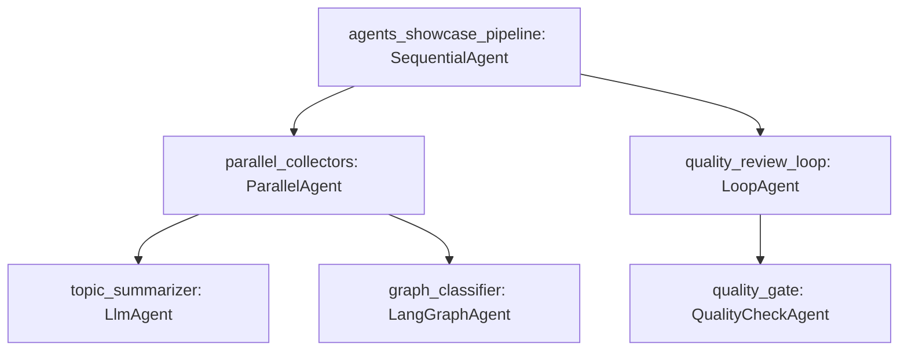

# Agents Sample (`LlmAgent`, `SequentialAgent`, `ParallelAgent`, `LoopAgent`, `LangGraphAgent`, and `LlmCallsLimitExceededError`)

This sample demonstrates how to compose model-backed, workflow, and LangGraph-backed agents in `@google/adk`, save session artifacts from callbacks and custom `BaseAgent` subclasses, and enforce invocation-wide LLM call budgets with `RunConfig.maxLlmCalls` and `LlmCallsLimitExceededError`.

## Overview

`agents_showcase_pipeline` (`rootAgent`) is a `SequentialAgent` that coordinates:

1. `ParallelAgent` (`parallel_collectors`), running an `LlmAgent` (`topic_summarizer`) and a `LangGraphAgent` (`graph_classifier`) concurrently on isolated branch contexts while sharing `session.state`.
2. `LoopAgent` (`quality_review_loop`), repeating a custom `BaseAgent` subclass (`QualityCheckAgent`) until it writes an approval artifact via `ctx.artifactService.saveArtifact` and sets `actions.escalate = true`.

In addition to exporting `rootAgent` for `npm run sample` and `adk web`, the direct `main()` driver verifies the agent type guards (`isSequentialAgent`, `isParallelAgent`, `isLlmAgent`, `isLangGraphAgent`, and `isLoopAgent`), triggers `LlmCallsLimitExceededError` via `runConfig: {maxLlmCalls: 1}`, exercises `ctx.saveCredential` and `ctx.loadCredential` via `Runner` with `InMemoryCredentialService` (while the topic summarizer agent verifies `ctx.listArtifacts()` after `ctx.saveArtifact`), and runs an `LlmAgent` configured simultaneously with `outputSchema` and a `BaseToolset` using `toolNamePrefix`.

## Sample Inputs

- `Distributed agent architectures`

  _Runs `topic_summarizer` and `graph_classifier` in parallel and iterates `quality_gate` twice until escalation._

## Graph



## How To

**Wrap a compiled LangGraph graph in `LangGraphAgent`.** Pass a `CompiledGraphLike` object (`invoke`, `getState`, `getGraph`, and optional `checkpointer`) to `new LangGraphAgent`:

```ts
const graphClassifier = new LangGraphAgent({
  name: 'graph_classifier',
  description: 'Classifies the user prompt using a compiled LangGraph graph.',
  instruction: 'Classify the user request category.',
  graph: demoCompiledGraph,
});
```

**Save session artifacts and escalate from a custom `BaseAgent`.** Implement both `runAsyncImpl` and `runLiveImpl`, record the revision returned by `ctx.artifactService.saveArtifact({filename, artifact})` in `actions.artifactDelta` only when `ctx.artifactService` is defined, and set `actions.escalate`:

```ts
const artifactDelta: Record<string, number> = {};
if (isApproved && ctx.artifactService) {
  const filename = 'quality_report.txt';
  const version = await ctx.artifactService.saveArtifact({
    filename,
    artifact: {
      text: `Approved in ${ctx.appName} on pass ${currentPass}.`,
    },
  });
  artifactDelta[filename] = version;
}
```

**Enforce `RunConfig.maxLlmCalls` and catch `LlmCallsLimitExceededError`.** Pass `runConfig: {maxLlmCalls: 1}` to `runner.runAsync` and narrow caught errors with `isLlmCallsLimitExceededError`:

```ts
try {
  for await (const _event of loopRunner.runAsync({
    userId: boundedSession.userId,
    sessionId: boundedSession.id,
    newMessage: {role: 'user', parts: [{text: 'Test call limit'}]},
    runConfig: {maxLlmCalls: 1},
  })) {
    // First iteration succeeds; second iteration exceeds maxLlmCalls.
  }
} catch (err: unknown) {
  if (isLlmCallsLimitExceededError(err)) {
    process.stdout.write(`Caught ${err.name}: ${err.message}\n`);
  }
}
```

**Combine `outputSchema` with a `BaseToolset` using `toolNamePrefix`.** Configure `toolNamePrefix` on `BaseToolset` and pass it alongside `outputSchema` on `LlmAgent`:

```ts
class CityGuideToolset extends BaseToolset {
  constructor() {
    super({toolNamePrefix: 'cityGuide'});
  }

  override async getTools(): Promise<BaseTool[]> {
    return [
      new FunctionTool({
        name: 'lookupHighlight',
        description: 'Returns a landmark highlight for a city.',
        parameters: z.object({city: z.string()}),
        execute: async ({city}) => ({city, highlight: `${city} waterfront`}),
      }),
    ];
  }
}

const structuredBriefAgent = new LlmAgent({
  name: 'structuredBriefAgent',
  model: new StructuredToolDemoLlm(),
  instruction: 'Look up a highlight and return a structured city brief.',
  tools: [new CityGuideToolset()],
  outputSchema: z.object({city: z.string(), highlight: z.string()}),
  outputKey: 'cityBrief',
});
```

## Running the Sample

The sample uses offline `BaseLlm` implementations (`DeterministicDemoLlm` and `StructuredToolDemoLlm`) and an in-memory `CompiledGraphLike`, so no API key or network access is required.

Run the self-contained script directly to execute all five sections (type guards, multi-agent pipeline execution, `LlmCallsLimitExceededError` enforcement, callback credential persistence, and `outputSchema` with a prefixed `BaseToolset`):

```bash
npm run build
npx tsx samples/agents/agent.ts
```

Or run the exported `rootAgent` interactively through the ADK CLI:

```bash
npm run build
npm run sample -- samples/agents/agent.ts
```

`samples/` is not an npm workspace, so it is type-checked separately:

```bash
npm run ts:check:samples
```

## Related Guides

- [Agents](../../docs/guides/agents/index.md) - `BaseAgent`, `LlmAgent`, `SequentialAgent`, `ParallelAgent`, `LoopAgent`, `LangGraphAgent`, `InvocationContext`, `CallbackContext`, `RunConfig`, and `LlmCallsLimitExceededError`.
