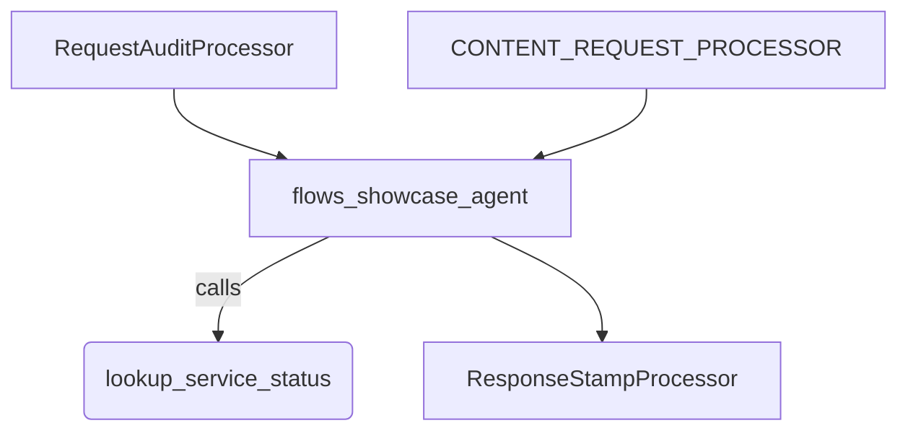

# Flows Sample (`BaseLlmRequestProcessor`, `BaseLlmResponseProcessor`, `handleFunctionCallsLive`, and `supportCfc`)

This sample demonstrates how the ADK LLM flow subsystem prepares requests, transforms responses, executes live streaming tools with `stop_streaming` cancellation, and routes Compositional Function Calling (`runConfig.supportCfc`) through the live flow.

## Overview

`flows_showcase_agent` (`rootAgent`) is an `LlmAgent` configured with a custom `BaseLlmRequestProcessor` (`RequestAuditProcessor`) and a custom `BaseLlmResponseProcessor` (`ResponseStampProcessor`) backed by a deterministic offline `BaseLlm` (`FlowDemoLlm`). In addition to exporting `rootAgent` for the ADK CLI, the direct `main()` script demonstrates live streaming tool execution and cancellation via `handleFunctionCallsLive` (`monitor_metric` and `stop_streaming`) and Compositional Function Calling via `createRunConfig({supportCfc: true})`.

## Sample Inputs

- `Check the payments service.`

  _Runs `RequestAuditProcessor` to append the active session channel to `systemInstruction`, calls `lookup_service_status`, and runs `ResponseStampProcessor` to prefix the final model response with `[flow-processed]`._

## Graph



## How To

**Attach custom request and response processors to `LlmAgent`.** Pass `BaseLlmRequestProcessor` and `BaseLlmResponseProcessor` instances in `requestProcessors` and `responseProcessors`:

```ts
export const rootAgent = new LlmAgent({
  name: 'flows_showcase_agent',
  model: new FlowDemoLlm(),
  instruction: 'Check service health with lookup_service_status.',
  tools: [lookupServiceStatus],
  requestProcessors: [new RequestAuditProcessor(), CONTENT_REQUEST_PROCESSOR],
  responseProcessors: [new ResponseStampProcessor()],
});
```

**Start and cancel an async-generator streaming tool in live mode.** Call `handleFunctionCallsLive` with a `FunctionTool` whose `execute` function is an `AsyncGeneratorFunction`, then stop it by dispatching a `stop_streaming` function call with `{function_name}`:

```ts
const stopResponse = await handleFunctionCallsLive({
  invocationContext: ctx,
  functionCallEvent: createEvent({
    invocationId: ctx.invocationId,
    author: rootAgent.name,
    content: {
      role: 'model',
      parts: [
        {
          functionCall: {
            id: 'call-stop-1',
            name: 'stop_streaming',
            args: {function_name: 'monitor_metric'},
          },
        },
      ],
    },
  }),
  toolsDict: {
    monitor_metric: monitorMetric,
    stop_streaming: stopStreaming,
  },
  beforeToolCallbacks: [],
  afterToolCallbacks: [],
});
```

**Run Compositional Function Calling (`supportCfc`).** Pass `createRunConfig({supportCfc: true})` to route `LlmAgent.runAsync` through `runLiveFlow`:

```ts
const ctx = new InvocationContext({
  invocationId: 'inv-cfc-demo',
  agent: cfcAgent,
  session,
  runConfig: createRunConfig({
    supportCfc: true,
    streamingMode: StreamingMode.NONE,
  }),
  pluginManager: new PluginManager(),
});
```

## Running the Sample

The sample uses offline `BaseLlm` implementations (`FlowDemoLlm` and `CfcDemoLlm`), so no API key is required.

Run the self-contained script directly to execute all three flow demos (request/response processors, live streaming tool execution and `stop_streaming`, and `supportCfc`):

```bash
npm run build
npx tsx samples/flows/agent.ts
```

Or run the exported `rootAgent` interactively through the ADK CLI:

```bash
npm run build
npm run sample -- samples/flows/agent.ts
```

`samples/` is not an npm workspace, so it is type-checked separately:

```bash
npm run ts:check:samples
```

## Related Guides

- [Flows](../../docs/guides/flows/index.md) - Request and response processors, function call handling (`handleFunctionCallsAsync` and `handleFunctionCallsLive`), and `supportCfc`.
