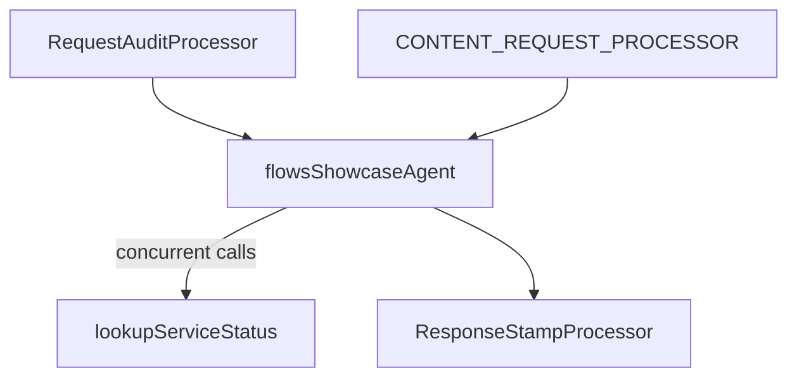

# Flows Sample (`BaseLlmRequestProcessor`, `BaseLlmResponseProcessor`, Concurrent Parallel Tools, `handleFunctionCallsLive`, `sessionResumption`, `supportCfc`, `SetModelResponseTool`, and `Aclosing`)

This sample demonstrates how the ADK LLM flow subsystem prepares requests (including excluding foreign-agent `thought` parts), transforms responses, executes multiple `functionCall` parts concurrently while preserving call-order responses and out-of-order `toolContext.state` updates, runs live streaming tools with `stop_streaming`, resumes dropped live sessions via `sessionResumption`, routes Compositional Function Calling (`runConfig.supportCfc`) through the live flow, and combines `outputSchema` with `FunctionTool` calls via `SetModelResponseTool` and `Aclosing` cleanup.

## Overview

`flowsShowcaseAgent` (`rootAgent`) is an `LlmAgent` configured with a custom `BaseLlmRequestProcessor` (`RequestAuditProcessor`), `CONTENT_REQUEST_PROCESSOR`, and a custom `BaseLlmResponseProcessor` (`ResponseStampProcessor`) backed by a deterministic offline `BaseLlm` (`FlowDemoLlm`). In addition to exporting `rootAgent` for the ADK CLI, the direct `main()` script demonstrates concurrent parallel tool calls (`lookupServiceStatus`), live streaming tool execution and cancellation via `handleFunctionCallsLive` (`monitorMetric` and `stop_streaming`), live session resumption across `goAway` (`createRunConfig({sessionResumption: {transparent: true}})`), Compositional Function Calling (`createRunConfig({supportCfc: true})`), and structured output alongside tools (`outputSchema` + `FunctionTool` + `outputKey` via `set_model_response` wrapped with `Aclosing`).

## Sample Inputs

- `Check the payments and checkout services.`

  _Runs `RequestAuditProcessor` to append the active session channel to `systemInstruction`, excludes foreign-agent `thought` parts in `CONTENT_REQUEST_PROCESSOR`, executes two `lookupServiceStatus` calls concurrently while retaining out-of-order `checkedServices` state updates and call-ordered responses, and prefixes the final model response with `[flow-processed]` in `ResponseStampProcessor`._

## Graph



## How To

**Attach custom request and response processors and concurrent tools to `LlmAgent`.** Pass `BaseLlmRequestProcessor` and `BaseLlmResponseProcessor` instances in `requestProcessors` and `responseProcessors`:

```ts
export const rootAgent = new LlmAgent({
  name: 'flowsShowcaseAgent',
  model: flowDemoLlm,
  instruction: 'Check service health with lookupServiceStatus.',
  tools: [lookupServiceStatus],
  requestProcessors: [new RequestAuditProcessor(), CONTENT_REQUEST_PROCESSOR],
  responseProcessors: [new ResponseStampProcessor()],
});
```

**Start and cancel an async-generator streaming tool in live mode.** Call `handleFunctionCallsLive` with a `FunctionTool` whose `execute` function is an `AsyncGeneratorFunction`, then stop it by dispatching the built-in `stop_streaming` function call with `{function_name}`:

```ts
const stopResponse = await handleFunctionCallsLive({
  invocationContext: ctx,
  functionCallEvent: createEvent({
    invocationId: ctx.invocationId,
    author: rootAgent.name,
    content: {
      role: 'model',
      parts: [
        {
          functionCall: {
            id: 'call-stop-1',
            name: 'stop_streaming',
            args: {function_name: 'monitorMetric'},
          },
        },
      ],
    },
  }),
  toolsDict: {
    monitorMetric,
    stop_streaming: stopStreaming,
  },
  beforeToolCallbacks: [],
  afterToolCallbacks: [],
});
```

**Resume a live session across `goAway` reconnects.** Pass `sessionResumption` in `createRunConfig` when calling `Runner.runLive`:

```ts
for await (const event of runner.runLive({
  userId: 'user-1',
  sessionId: session.id,
  liveRequestQueue,
  runConfig: createRunConfig({
    sessionResumption: {transparent: true},
  }),
})) {
  void event;
}
```

**Run Compositional Function Calling (`supportCfc`).** Pass `createRunConfig({supportCfc: true})` to route `LlmAgent.runAsync` through `runLiveFlow`:

```ts
const ctx = new InvocationContext({
  invocationId: 'inv-cfc-demo',
  agent: cfcAgent,
  session,
  runConfig: createRunConfig({
    supportCfc: true,
    streamingMode: StreamingMode.NONE,
  }),
  pluginManager: new PluginManager(),
});
```

**Combine `outputSchema` with tools and `Aclosing` generator cleanup.** Configure `outputSchema`, `outputKey`, and `tools` on `LlmAgent`, and iterate with `new Aclosing(...)` so `set_model_response` synthesizes a validated final JSON event and guarantees deterministic generator cleanup:

```ts
for await (const event of new Aclosing(
  runner.runAsync({
    userId,
    sessionId: session.id,
    newMessage: {
      role: 'user',
      parts: [{text: 'Generate the SLO report for us-central1.'}],
    },
  }),
)) {
  void event;
}
```

## Running the Sample

The sample uses offline `BaseLlm` implementations (`FlowDemoLlm`, `ResumableLiveDemoLlm`, and `StructuredToolsDemoLlm`), so no API key is required.

Run the self-contained script directly to execute all five flow demos (processors + concurrent parallel tools, live streaming tools + `stop_streaming`, live session resumption, `supportCfc`, and structured output with tools + `Aclosing`):

```bash
npm run build
npx tsx samples/flows/agent.ts
```

Or run the exported `rootAgent` interactively through the ADK CLI:

```bash
npm run build
npm run sample -- samples/flows/agent.ts
```

`samples/` is not an npm workspace, so it is type-checked separately:

```bash
npm run ts:check:samples
```

## Related Guides

- [Flows](../../docs/guides/flows/index.md) - Request and response processors, concurrent parallel function-call handling, live session resumption, `handleFunctionCallsLive`, and `supportCfc`.
