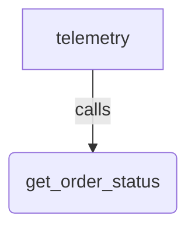

# Telemetry

## Overview

One prompt drives one tool call, and the sample exists to show what ADK records
on the spans and OpenTelemetry log records around it. Each model call opens a
`generate_content gemini-flash-latest` child span under `call_llm` and emits a
`gen_ai.client.inference.operation.details` log record parented to that span,
while the `execute_tool get_order_status` span carries
`gen_ai.system = "gcp.vertex.agent"` and `gcp.vertex.agent.invocation_id`, the
two attributes a trace backend uses to select ADK spans and to group the spans
of one turn.

The sample installs a console span processor and a console log record processor
with `maybeSetOtelProviders`, so running it from the CLI prints every span and
every GenAI log record.

## Running the Sample

The sample calls a live model. Set `GEMINI_API_KEY`, build once, and run it by
path:

```bash
npm run build
npm run sample -- samples/telemetry/agent.ts
```

To include prompt, system instruction, and model output content in the emitted
log records, set `OTEL_INSTRUMENTATION_GENAI_CAPTURE_MESSAGE_CONTENT=EVENT_ONLY`:

```bash
OTEL_INSTRUMENTATION_GENAI_CAPTURE_MESSAGE_CONTENT=EVENT_ONLY \
  npm run sample -- samples/telemetry/agent.ts
```

To emit the stable OpenTelemetry GenAI records (`gen_ai.system.message`,
`gen_ai.user.message`, and `gen_ai.choice`) instead of
`gen_ai.client.inference.operation.details`, set
`ADK_TELEMETRY_SCHEMA_VERSION_OPT_IN=1`:

```bash
ADK_TELEMETRY_SCHEMA_VERSION_OPT_IN=1 \
  OTEL_INSTRUMENTATION_GENAI_CAPTURE_MESSAGE_CONTENT=EVENT_ONLY \
  npm run sample -- samples/telemetry/agent.ts
```

`samples/` is not an npm workspace, so `npm run build` does not compile it. It
has its own `samples/tsconfig.json` and is type-checked separately:

```bash
npm run ts:check:samples
```

Lint, Prettier, the license check and `ts:check:samples` read this sample.
Nothing in CI executes it, because
`tests/integration/docs_samples/docs_samples_test.ts` only runs
`samples/workflows`.

## Sample Inputs

- `What is the status of order A-1042?`

  _Produces two `call_llm` / `generate_content gemini-flash-latest` spans (one
  for the tool-call decision and one for the final answer), two
  `gen_ai.client.inference.operation.details` log records, and one
  `execute_tool get_order_status` span between them._

- `What is the status of order A-9999?`

  _An identifier the tool does not know. The tool still runs and returns
  `unknown`, so the tool span and both inference log records are emitted either
  way._

- `Who are you?`

  _No order is named, so the agent answers in one model call without the tool:
  one `generate_content` span, one inference log record, and no `execute_tool`
  span._

## Graph



## How To

**Install span and log processors before the agent runs.**
`maybeSetOtelProviders` runs at module scope, so every span and every GenAI log
record of every later run goes through the processors.

```ts
maybeSetOtelProviders([
  {
    spanProcessors: [new SimpleSpanProcessor(new ConsoleSpanExporter())],
    logRecordProcessors: [
      new SimpleLogRecordProcessor({
        exporter: new ConsoleLogRecordExporter(),
      }),
    ],
  },
]);
```

**Give the agent one deterministic tool.** A tool the model cannot answer from
its own knowledge makes the tool call, and therefore the tool span, reliable.

```ts
const getOrderStatus = new FunctionTool({
  name: 'get_order_status',
  description: 'Looks up the delivery status of one order by its identifier.',
  parameters: z.object({
    orderId: z.string().describe('The order identifier, such as "A-1042".'),
  }),
  execute: ({orderId}) => ({
    orderId,
    status: ORDER_STATUS[orderId] ?? 'unknown',
  }),
});
```

**Read the span in `adk web`.** The dev server registers its own tracer provider
before it loads this file, and `maybeSetOtelProviders` does not replace one, so
the console span exporter prints nothing there. Select the
`execute_tool get_order_status` or `generate_content gemini-flash-latest` span
in the Trace view to see the same attributes.

**Control message content capture.** Inference log records default to
`OTEL_INSTRUMENTATION_GENAI_CAPTURE_MESSAGE_CONTENT=NO_CONTENT`, which omits
message payloads and `user.id` while keeping token usage, finish reasons, and
redacted tool definitions. Set
`OTEL_INSTRUMENTATION_GENAI_CAPTURE_MESSAGE_CONTENT=EVENT_ONLY` to include
message content on log records, or `SPAN_AND_EVENT` to also serialize message
attributes onto the `generate_content` span. Set
`ADK_CAPTURE_MESSAGE_CONTENT_IN_SPANS=false` and the `gcp.vertex.agent.*`
argument, response and request payloads on `call_llm` and `execute_tool` become
`{}` while the identifying attributes stay.

**Switch between experimental and stable GenAI log records.** By default (schema
v2), ADK emits one `gen_ai.client.inference.operation.details` record per model
call. Set `ADK_TELEMETRY_SCHEMA_VERSION_OPT_IN=1` (or `otel_semconv_1_36`) to
emit `gen_ai.system.message`, `gen_ai.user.message`, and `gen_ai.choice`
instead.

## Related Guides

- [Telemetry](../../docs/guides/telemetry/index.md) - Every span, log record, and attribute ADK writes, the OTLP and Google Cloud exporters, and turning message content on or off.
