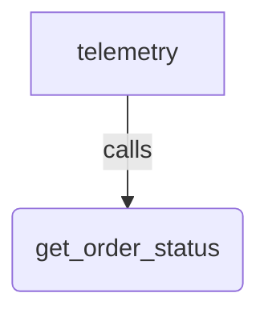

# Telemetry

## Overview

One prompt drives one tool call, and the sample exists to show what ADK records
around it. The sample installs a console span processor and a console log
record processor with `maybeSetOtelProviders`, so running it from the CLI
prints every span and log record with its attributes.

For `What is the status of order A-1042?` the console shows this span tree, each
span printed when it ends:

```text
invoke_workflow telemetry
└── invoke_agent telemetry
    ├── generate_content gemini-flash-latest
    ├── execute_tool get_order_status
    └── generate_content gemini-flash-latest
```

and two log records named `gen_ai.client.inference.operation.details`, one per
`generate_content` span and carrying that span's trace and span ids. Each record
holds the model call's provider, finish reason and token counts. The prompt and
the answer appear only when content capture is turned on (see How To).

## Running the Sample

The sample calls a live model. Set `GEMINI_API_KEY`, build once, and run it by
path:

```bash
npm run build
npm run sample -- samples/telemetry/agent.ts
```

`samples/` is not an npm workspace, so `npm run build` does not compile it. It
has its own `samples/tsconfig.json` and is type-checked separately:

```bash
npm run ts:check:samples
```

Lint, Prettier, the license check and `ts:check:samples` read this sample.
Nothing in CI executes it, because
`tests/integration/docs_samples/docs_samples_test.ts` only runs
`samples/workflows`.

## Sample Inputs

- `What is the status of order A-1042?`

- `What is the status of order A-9999?`

  _An identifier the tool does not know. The tool still runs and returns
  `unknown`, so the tool span is emitted either way._

- `Who are you?`

  _No order is named, so the agent answers without the tool and no
  `execute_tool` span appears._

## Graph



## How To

**Install a span processor and a log record processor before the agent
runs.** `maybeSetOtelProviders` runs at module scope, so every span and log
record of every later run goes through the processors.

```ts
maybeSetOtelProviders([
  {
    spanProcessors: [new SimpleSpanProcessor(new ConsoleSpanExporter())],
    logRecordProcessors: [
      new SimpleLogRecordProcessor({exporter: new ConsoleLogRecordExporter()}),
    ],
  },
]);
```

**Give the agent one deterministic tool.** A tool the model cannot answer from
its own knowledge makes the tool call, and therefore the tool span, reliable.

```ts
const getOrderStatus = new FunctionTool({
  name: 'get_order_status',
  description: 'Looks up the delivery status of one order by its identifier.',
  parameters: z.object({
    orderId: z.string().describe('The order identifier, such as "A-1042".'),
  }),
  execute: ({orderId}) => ({
    orderId,
    status: ORDER_STATUS[orderId] ?? 'unknown',
  }),
});
```

**Read the span in `adk web`.** The dev server registers its own tracer provider
before it loads this file, and `maybeSetOtelProviders` does not replace one, so
the console exporter prints nothing there. Select the
`execute_tool get_order_status` span in the Trace view to see the same
attributes.

**Turn on message content.** Set
`OTEL_INSTRUMENTATION_GENAI_CAPTURE_MESSAGE_CONTENT=EVENT_ONLY` and each log
record also carries the prompt, the system instruction, the answer and the
session's `user.id`. `SPAN_ONLY` puts the messages and the tool arguments and
result on the spans instead, and `SPAN_AND_EVENT` does both.

## Related Guides

- [Telemetry](../../docs/guides/telemetry/index.md) - Every span, attribute and log record ADK writes, the OTLP and Google Cloud exporters, and message content capture.
