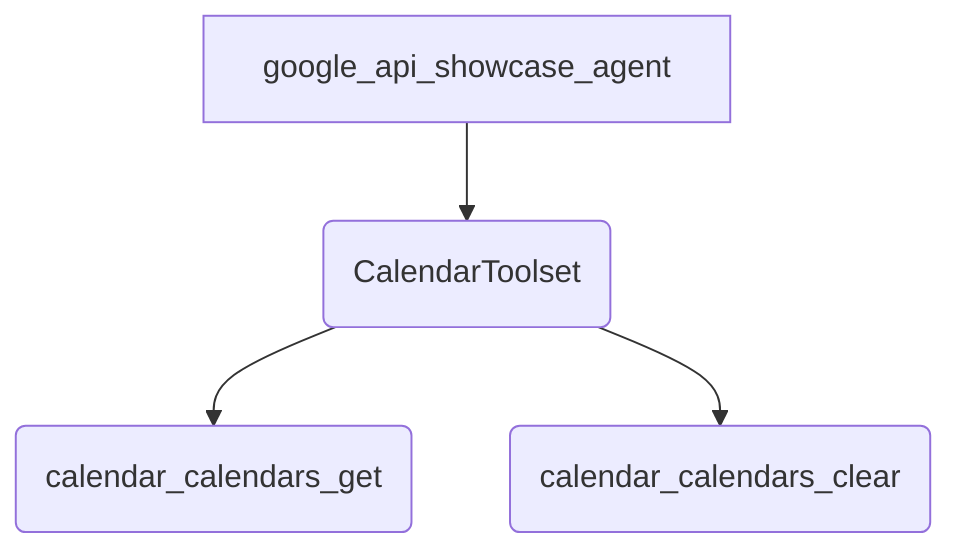

# Google API tool

## Overview

`CalendarToolset` wraps Google Calendar API operations in `GoogleApiTool` instances configured with Google OpenID Connect authentication. This sample demonstrates toolset construction, tool filtering, and credential configuration offline through a deterministic `BaseAgent` subclass.

## Sample Inputs

- `Show me the Google API toolset`

  _Any message works. The agent inspects `CalendarToolset` and replies with a report._

## Graph



## Running the Sample

The sample runs offline and requires no API key, network access, or optional peer dependency. Build the workspace once, then run the exported `rootAgent` through the ADK CLI:

```bash
npm run build
npm run sample -- samples/tools/google_api_tool/agent.ts
```

`samples/` is not an npm workspace, so type-check it separately:

```bash
npm run ts:check:samples
```

## How To

**Construct a prebuilt toolset with authentication and tool filtering.** Passing `clientId`, `clientSecret`, and `toolFilter` to `new CalendarToolset({clientId, clientSecret, toolFilter})` configures credentials and narrows what `getTools()` exposes to an agent:

```ts
const toolset = new CalendarToolset({
  clientId: PLACEHOLDER_CLIENT_ID,
  clientSecret: PLACEHOLDER_CLIENT_SECRET,
  toolFilter: ['calendar_calendars_get'],
});
const tools = await toolset.getTools();
```

## Related Guides

- [Google API tool](../../../docs/guides/tools/google_api_tool/index.md) - Converting Google Discovery specifications into `GoogleApiToolset` instances and configuring OpenID Connect credentials.
- [OpenAPI tool](../../../docs/guides/tools/openapi_tool/index.md) - Turning an OpenAPI v3 document into `RestApiTool` instances with `OpenAPIToolset`.
