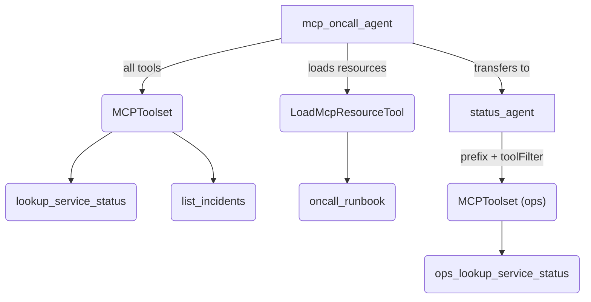

# MCP tool

## Overview

`MCPToolset` connects to a Model Context Protocol server, discovers the tools it
advertises, and gives an agent one `MCPTool` per remote operation. This sample
spawns `mcp_server.mjs`, a local stdio MCP server sitting beside `agent.ts`, and
exercises the whole MCP workflow without an external service:

- `mcp_server.mjs` defines an ADK `FunctionTool` (`lookup_service_status`) and
  converts its declaration parameters into an MCP `Tool` schema with
  `genaiSchemaToJsonSchema`, alongside a `list_incidents` tool and an
  `oncall_runbook` text resource.
- `mcp_oncall_agent` receives the full `MCPToolset` plus `LoadMcpResourceTool`
  so it can call every server tool and load `oncall_runbook` into the prompt.
- `status_agent` receives a second `MCPToolset` configured with `prefix: 'ops'`
  and `toolFilter: ['ops_lookup_service_status']`.

Set `GEMINI_API_KEY` to run the agent against the bundled stdio server, or set
`MCP_SSE_URL` (and optionally `MCP_SSE_TOKEN`) to connect over
`SseConnectionParams` instead:

```bash
npm run build
npm run ts:check:samples
npm run sample -- samples/tools/mcp_tool/agent.ts
```

## Sample Inputs

- `check the health of the checkout service`

  `mcp_oncall_agent` transfers to `status_agent`, which calls the prefixed tool
  `ops_lookup_service_status` with `{"service": "checkout"}`. The MCP server
  receives the unprefixed name `lookup_service_status` and returns
  `{"service": "checkout", "status": "healthy", "latencyMs": 42}`.

- `list all active incidents`

  `mcp_oncall_agent` calls `list_incidents` directly on `mcpToolset` and reports
  incident `INC-1042` on the `search` service.

- `is the search service healthy, and what does the oncall runbook say to do?`

  `mcp_oncall_agent` calls `lookup_service_status` for `search`, calls
  `load_mcp_resource` with `{"resource_names": ["oncall_runbook"]}` to read the
  `runbook://oncall/triage` resource into the next model request, and follows
  the runbook to inspect `list_incidents` and recommend escalation.

## Graph



## How To

**Connect over stdio or HTTP+SSE.** `StdioConnectionParams` launches a local
subprocess; `SseConnectionParams` connects to an HTTP+SSE endpoint and merges
any `headers` with the ADK tracking headers.

```ts
const stdioParams: StdioConnectionParams = {
  type: 'StdioConnectionParams',
  serverParams: {
    command: process.execPath,
    args: [SERVER_SCRIPT],
  },
};

const sseParams: SseConnectionParams | undefined = process.env.MCP_SSE_URL
  ? {
      type: 'SseConnectionParams',
      url: process.env.MCP_SSE_URL,
      headers: process.env.MCP_SSE_TOKEN
        ? {Authorization: `Bearer ${process.env.MCP_SSE_TOKEN}`}
        : undefined,
    }
  : undefined;
```

**Namespace and filter a toolset for a sub-agent.** `MCPToolset` applies
`prefix` before `toolFilter`, so a string-array filter matches the prefixed
name (`ops_lookup_service_status`), while `MCPTool` strips the prefix before
calling the server.

```ts
const statusToolset = new MCPToolset(
  connectionParams,
  ['ops_lookup_service_status'],
  'ops',
);
```

**Load MCP server resources into the prompt.** `LoadMcpResourceTool` lists the
server's resources before each model call and reads the ones the model requests
via `load_mcp_resource`.

```ts
const mcpToolset = new MCPToolset(connectionParams);
const loadMcpResource = new LoadMcpResourceTool(mcpToolset);
```

**Expose an ADK tool schema from an MCP server.** Inside `mcp_server.mjs`,
`genaiSchemaToJsonSchema` converts a `FunctionTool` declaration schema into the
MCP `Tool` `inputSchema` returned from `ListToolsRequestSchema`.

```ts
server.setRequestHandler(ListToolsRequestSchema, async () => ({
  tools: [lookupServiceStatusMcpTool, listIncidentsTool],
}));
```

## Related Guides

- [MCP tool](../../../docs/guides/tools/mcp_tool/index.md) - Connecting `MCPToolset` over stdio, Streamable HTTP, or SSE, reading MCP resources, and converting schemas with `toGeminiSchema` and `genaiSchemaToJsonSchema`.
